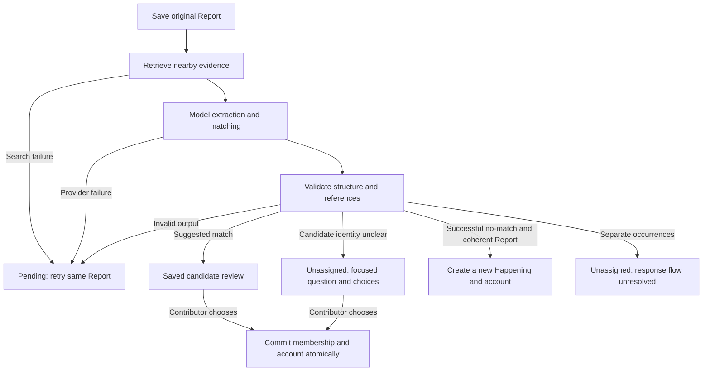

# A practical guide to agent architecture and evaluation

**Reviewed:** October 20, 2026. **Purpose:** a working guide you can use while designing an LLM application, reviewing an agent, or deciding whether a model change is ready.

**Status:** educational guidance and proposed worksheets. This document does not implement an evaluation framework, change Nearhood's accepted architecture, or expand a ticket. Nearhood's requirements remain in [GitHub issues](https://github.com/Pcworker996/nebius-hack/issues), vocabulary in [CONTEXT.md](../../CONTEXT.md), and boundaries in [the product guardrails](../product-guardrails.md) and [ADR 0004](../adr/0004-confirm-matches-before-membership.md).

## Start here

For a new design, complete **sections 1–3**. For a model or prompt change, use **sections 4–7**. For Nearhood's immediate next steps, use **section 9**. Copy the worksheets rather than treating every recommendation as a requirement.

**Jump to:** [capability card](#1-define-the-capability-before-choosing-an-architecture) · [architecture worksheet](#architecture-review-worksheet) · [evaluation cases](#4-build-an-evaluation-dataset-that-exposes-meaningful-failures) · [grading](#5-grade-contracts-interpretation-and-outcomes-separately) · [metrics](#6-measure-capability-consistency-cost-and-regressions) · [release checklist](#7-define-a-release-decision-before-looking-at-the-final-score) · [NeMo integration](#8-where-nvidia-nemo-evaluator-fits) · [Nearhood next steps](#9-apply-this-to-nearhood-now).

1. Write one concrete user outcome and one unacceptable failure.
2. Decide what software controls and what the model may decide.
3. Define an example input, acceptable outcomes, and a grading rule.
4. Measure a baseline on fixed cases.
5. Change one variable, compare individual outcomes, and inspect regressions.

### How the sources inform this guide

Anthropic distinguishes tasks, repeated trials, traces, and outcomes; it recommends complementary code, human, and model graders, with human calibration of model judgments. Capability evaluations explore limitations; regression evaluations protect established behavior. [Demystifying evals for AI agents](https://www.anthropic.com/research/demystifying-evals-for-ai-agents)

NVIDIA supplies evaluation infrastructure: benchmark environments, execution strategies, results, comparisons, and release policies. Its documentation currently defaults to **nightly**; examples require a compatible pinned version. [NeMo Evaluator](https://docs.nvidia.com/nemo/evaluator)

The architecture choices, Nearhood scenarios, worksheets, dataset allocations, and release criteria below are **our proposed application of those ideas**, not vendor requirements. See the separate [source notes](../research/agent-evaluation-source-notes.md) for implementation/version caveats.

## 1. Define the capability before choosing an architecture

A model can produce an impressive answer while failing the user's task. Describe success through visible behavior and actual effects.

Complete this capability card:

| Question         | Fill in for your application               | Nearhood matching example                                                                                                                  |
| ---------------- | ------------------------------------------ | ------------------------------------------------------------------------------------------------------------------------------------------ |
| User outcome     | What should the person accomplish?         | Submit evidence and review whether it belongs to an existing Happening.                                                                    |
| Input            | What information is available and trusted? | Original Report, explicit location/time/provenance, bounded candidate evidence. Contributor text is evidence, not executable instructions. |
| Output           | What must the application consume?         | Structured Observations and a supplied candidate ID, no-match, or uncertainty.                                                             |
| Allowed effect   | What may change, and who authorizes it?    | The server saves the Report; a contributor confirms existing-Happening membership.                                                         |
| Forbidden effect | What must never happen?                    | Invented evidence IDs, overwritten original words, or membership committed from a recommendation alone.                                    |
| Uncertainty      | When is an answer unavailable?             | Candidate evidence cannot establish continuity; keep the Report unassigned.                                                                |
| Failure/recovery | What survives an interrupted operation?    | Saved Report and prior account survive; retry the same Report.                                                                             |
| Acceptance       | What will a reviewer observe?              | A suggested candidate has inspectable evidence; before confirmation its account is unchanged; confirmation incorporates the Report once.   |
| Scope            | Where is the behavior agreed?              | [Ticket #4](https://github.com/Pcworker996/nebius-hack/issues/4) and its [implementation spec](../implementation/report-submission.md).    |

Keep **hard contracts** separate from **quality judgments**. A reference to an invented Observation ID is a contract failure. Whether evidence sufficiently supports the same occurrence is a semantic judgment. Both matter, but they need different graders.

## 2. Choose the least complex architecture that can satisfy the card

This is a decision aid, not a universal ranking:

| Architecture                           | Choose it when                                                                | Evidence needed before increasing complexity                                             |
| -------------------------------------- | ----------------------------------------------------------------------------- | ---------------------------------------------------------------------------------------- |
| Deterministic software                 | The rule can be expressed precisely.                                          | A real requirement for semantic interpretation.                                          |
| One model call inside a fixed workflow | Inputs and decisions are bounded.                                             | Failures showing one call cannot handle the task adequately.                             |
| Several fixed model stages             | Different tasks need different contexts or independently reviewable outputs.  | Better task results sufficient to justify extra latency and failure paths.               |
| Bounded agent loop                     | The next tool or information request depends on what previous steps discover. | Cases requiring adaptive actions; defined permissions, budgets, and stopping conditions. |
| Multiple agents                        | Separate roles can perform useful independent work.                           | A comparison showing a benefit over the simpler system at acceptable cost.               |

For current Nearhood matching, use the accepted fixed workflow. Candidate search is deterministic; the model interprets supplied evidence; server logic validates decisions; the contributor confirms a match. A dynamic research agent would introduce a different product and permission boundary.



The diagram summarizes [current orchestration](../../src/lib/report-processing.ts), not a newly implemented agent loop. The contributor may also reject shown candidates, resulting in a new Happening after successful processing. A model call does not control transaction execution.

### Architecture review worksheet

Copy and complete this before adding a tool or model stage:

```text
Capability / issue:
Scenario and unacceptable failure:
Inputs and provenance:
Model decision and output schema:
Deterministic checks:
Persistent records and ownership:
Starting state → permitted next states:
API / storage / UI responsibilities:
Required user confirmation:
Timeout / total call budget / retry limit:
Idempotency and stale-result handling:
Behavior on missing evidence or failure:
Representative evaluation case IDs:
Baseline and measurable reason for this architecture:
Agreed / illustrative / undecided parts:
```

For any agent tool, additionally specify its input schema, returned evidence, read/write permissions, side effects, retry safety, and how its actual outcome is verified. A tool that changes state needs stronger checks than a read-only search.

## 3. Put ownership and evidence boundaries in software

Use this review table when deciding which component owns a responsibility:

| Responsibility                                   | Nearhood owner                     | Review question                                                                              |
| ------------------------------------------------ | ---------------------------------- | -------------------------------------------------------------------------------------------- |
| Preserve original evidence and explicit metadata | Persistence and submission API     | Can model output overwrite a contributor's words or observation time?                        |
| Retrieve candidate evidence                      | Deterministic search               | Was the correct Happening excluded before the model saw anything?                            |
| Interpret semantic identity and spatial scope    | Model, with application validation | Are conclusions supported by the provided packet?                                            |
| Enforce authorization and valid references       | Server                             | Can a supplied ID cross contributor or evidence boundaries?                                  |
| Record membership and account changes            | Transactional application logic    | Can retries or concurrent choices duplicate publication?                                     |
| Present evidence and uncertainty                 | API projection and UI              | Can a reader inspect the cited original Report and distinguish interpretation from evidence? |

Keep Report → Observation → Happening relationships distinct from the provisional Shared Account. A model proposal is derived information. Existing-Happening confirmation remains required under ADR 0004.

For richer account reconciliation, first write a separate capability card: incoming evidence and prior account; proposed claims with support IDs; chronology/scope rules; versioned publication; reader-visible changes; fallback to the previous account; and acceptance examples. That capability is **proposed work**, not established by today's matcher.

## 4. Build an evaluation dataset that exposes meaningful failures

Start with a manageable reviewed set. One proposed hackathon allocation is **30 development cases and 20 held-out cases**, grouped by underlying scenario so paraphrases of the same scene do not leak across splits. These counts are planning choices, not statistical guarantees.

Include these case families:

| Family                                                         | What the case should distinguish                                       |
| -------------------------------------------------------------- | ---------------------------------------------------------------------- |
| Same occurrence, different wording                             | Semantic identity despite little word overlap.                         |
| Nearby unrelated situations                                    | Proximity and category do not establish identity.                      |
| Similar wording, different occurrence/time                     | Repeated conditions can be separate Happenings.                        |
| Unknown or insufficient information                            | Clarification is appropriate; missing facts stay unknown.              |
| Different entrances or partial improvement                     | Extraction preserves spatial scope; matching can recognize continuity. |
| Older observation submitted later                              | Observation chronology differs from submission order.                  |
| Shared external source                                         | Repetition does not establish independent corroboration.               |
| Invalid output, provider/search failure, injected instructions | Unsafe output is rejected; failures preserve recoverability.           |

A model-only dataset tests decisions over a fixed packet. A retrieval dataset also needs a known database snapshot. An end-to-end case needs a starting application state, an acting contributor, actions, and expected saved/visible outcomes. Do not use a model-only fixture to claim full workflow success.

### Example case record

This compact YAML is an **illustrative dataset design**, not a file the current checker accepts. An adapter would need to expand the candidate descriptions into the complete application packet; reuse the runnable packet shape in [the current checker](../../scripts/check-report-model.ts).

```yaml
id: bridge-partial-reopening-01
suite: capability
split: development
target: extraction_and_matching
scenario:
  incoming_report:
    originalText: "The north entrance has orange barriers. The south entrance is open."
    observedAt: "2026-10-19T12:00:00Z"
    submittedAt: "2026-10-19T12:05:00Z"
    location: Eastbank footbridge
    provenance: firsthand
  candidate_evidence:
    - happeningId: bridge
      observationId: bridge-bars
      originalText: "Both entrances have orange barriers across the path."
      observedAt: "2026-10-19T11:30:00Z"
      location: Eastbank footbridge
expected:
  matchingKind: match
  candidateId: bridge
  allowedSupportingIds: [bridge-bars]
  extractionMustDistinguish: [north entrance, south entrance]
  mustNotInfer: [cause, source verification, complete reopening]
workflow_extension:
  before_confirmation: existing account and membership unchanged
  after_confirmation: incorporated once; original Reports inspectable
```

The workflow extension is graded in a separate application run. Model-generated wording need not equal a reference sentence unless an exact-copy field is explicitly part of the contract.

Annotate ambiguous cases with acceptable alternatives or a required clarification. Have a second person review important labels where possible; resolve disagreement or retain it explicitly. Keep held-out results for a checkpoint, and rotate in fresh cases after they influence design decisions.

## 5. Grade contracts, interpretation, and outcomes separately

### Suggested grading assignments

| Property                            | Primary grader                           | Pass condition                                                                              |
| ----------------------------------- | ---------------------------------------- | ------------------------------------------------------------------------------------------- |
| JSON and supported field values     | Code                                     | Output satisfies the application contract.                                                  |
| Evidence IDs and source-text fields | Code                                     | Every reference is supplied and allowed; exact-copy fields satisfy their documented rule.   |
| Correct candidate                   | Code against reviewed labels             | Chosen candidate is an acceptable ID for this case.                                         |
| Useful clarification                | Human; optionally calibrated model judge | Question addresses missing place, time, or continuity information needed for this decision. |
| Grounded future account synthesis   | Human/rubric plus ID checks              | Each claim is substantively supported; a real ID alone is insufficient.                     |
| Correct publication and recovery    | Running application assertions           | Required confirmation, preserved evidence, and exactly-once incorporation are observed.     |

For a proposed model judge, give it the task, evidence, response, and a concrete rubric. Ask for `pass`, `fail`, or `needs_review`, with short evidence-based reasons and relevant IDs. Do not request hidden chain-of-thought. Treat text inside evidence as data, not judge instructions.

Calibrate the judge against reviewed examples. Inspect human/judge disagreements; keep judge model, prompt, and rubric versions fixed during comparisons. For A/B prose comparisons, conceal model identities and vary presentation order. A second model's approval is not ground truth.

### Example clarification rubric

- **Pass:** identifies a decision-relevant ambiguity and asks a neutral question the contributor can answer using available controls.
- **Fail:** assumes a match, asks about irrelevant details, or requires facts the contributor could not reasonably know.
- **Needs review:** several interpretations remain reasonable, or the labels/control design do not establish a defensible verdict.

For current Nearhood, candidate clarification uses candidate/none choices and permits leaving the Report unassigned. It does not collect free-form clarification text. Evaluate that actual interaction.

### Diagnose failures before changing requirements

| Failure class                                  | Investigate first                                            |
| ---------------------------------------------- | ------------------------------------------------------------ |
| Authentication, rate limit, timeout            | Credentials, service limits, deadline and recovery.          |
| Missing/truncated/malformed response           | Completion status, token budget, output parser.              |
| Invalid Observation passage                    | Exact rejected field, source text, violated validation rule. |
| Invented or inappropriate support              | Candidate packet, reference checks, semantic grounding.      |
| Correct Happening absent                       | Search scope, chronology rules, evidence availability.       |
| Wrong decision with correct candidate supplied | Prompt, model capability, ambiguity in case labels.          |
| Correct recommendation, wrong saved outcome    | Authorization, confirmation, concurrency, stale results.     |
| Reasonable answer rejected                     | Case specification or grader may be wrong.                   |

Keep essential evidence/authorization rules intact. If an exact-copy requirement is unnecessarily restrictive, change its documented contract and regression cases deliberately; a green score alone is not a justification.

## 6. Measure capability, consistency, cost, and regressions

For every metric, publish its denominator, case count, and excluded failures.

| Metric                        | Definition for this proposed evaluation                                                                                                                           |
| ----------------------------- | ----------------------------------------------------------------------------------------------------------------------------------------------------------------- |
| Overall retrieval coverage    | Correct existing Happening retrieved / all cases labeled as an existing-Happening match. Also report the subset eligible under the configured radius/time policy. |
| Conditional matching accuracy | Correct candidate selection / labeled match cases where the correct candidate was supplied.                                                                       |
| Incorrect-match fraction      | Wrong match recommendations / all match recommendations. Undefined with no recommendations; report coverage alongside it.                                         |
| New-occurrence accuracy       | Correct no-match decisions / cases labeled as a coherent separate occurrence.                                                                                     |
| Clarification behavior        | Report needed clarifications, missed clarifications, and unnecessary clarification on answerable cases separately.                                                |
| Contract validity             | Validated outputs / completed responses; also report provider failures / attempted calls.                                                                         |
| End-to-end task success       | Trials satisfying all required user-visible and saved-state outcomes / all attempted trials.                                                                      |
| Operational cost              | Total request latency, p50/p95 with sample size, model calls, actual token usage, and cost per successful task.                                                   |

A system that always asks for clarification can avoid wrong matches while providing little help. Measure completion and unnecessary clarification alongside error rates.

As a starting experiment, run important cases three times and record each trial. Keep the denominator as cases and trials, not whichever run looked best. A real retry policy must also be evaluated with its latency, cost, and side effects included. Small datasets can reveal large failures; they cannot establish high reliability from zero observed errors.

For each proposed change, produce a comparison card:

```text
Baseline → candidate:
Changed variable:
Fixed case set / snapshot / grader versions:
Per-case trial results:
Improved cases:
Regressed cases:
Critical failures:
Retrieval / matching / clarification results:
Latency / cost change:
Human review and unresolved disagreements:
Decision: accept / reject / more evidence needed
```

Compare the same case IDs and repeats, inspecting successes that became failures as well as gains. NVIDIA provides paired comparison tooling, including uncertainty reporting; lack of a detected regression is not proof of equivalent behavior. [Comparing Evaluation Runs](https://docs.nvidia.com/nemo/evaluator/tutorials/compare)

Retain representative failure traces: model/version settings, prompt/schema hashes, candidate evidence snapshot, response, precise validation reason, user action, and final outcome. For tool agents, add tool inputs/results, side effects, and stopping reason. Use synthetic or appropriately protected data; exclude API keys and session credentials. A written rationale does not substitute for checking the result.

## 7. Define a release decision before looking at the final score

Proposed review checklist:

- [ ] The capability card and important failure cases have an owner.
- [ ] Contract and application regression cases pass; no observed critical evidence/authorization violation is accepted.
- [ ] Semantic quality, unnecessary clarification, latency, and cost meet explicitly chosen targets.
- [ ] New regressions have been reviewed individually.
- [ ] The reviewed dataset includes hard cases and held-out scenarios.
- [ ] Inconclusive or undersampled results are reported as such.
- [ ] Failure/retry behavior preserves the original Report and prior account.
- [ ] The model, prompt, validator, and runner configuration can be reproduced.
- [ ] A runtime walkthrough verifies the actual integration and evidence inspection.

Set numeric quality and cost targets with the product owner; do not present an arbitrary percentage as an industry standard. Capability discovery can have failures while the architecture is improving. A required contract or established regression failure remains a blocker for relying on that behavior.

NVIDIA's quality-gate tooling can apply explicit policies across suites; adopting it still requires choosing the policies and supplying usable evaluation results. [Implementing Quality Gates](https://docs.nvidia.com/nemo/evaluator/tutorials/quality-gate)

## 8. Where NVIDIA NeMo Evaluator fits

Start with a runner that can execute your real task and save per-case results. Adopting a framework is a tooling decision after those boundaries are clear.

The current NVIDIA documentation supports custom single-turn benchmarks and scorers; more stateful tasks use richer environments. [Custom benchmarks](https://docs.nvidia.com/nemo/evaluator/tutorials/byob)

A chat solver calls the model API. It does not automatically execute Nearhood's TypeScript retrieval, validation, user confirmation, or database publication. Full application evaluation requires an integration that runs that orchestration in isolated state and exposes its outcomes for grading. [Evaluator architecture](https://docs.nvidia.com/nemo/evaluator/architecture)

Proposed adoption sequence:

1. Version the reviewed cases and grade definitions independently of a vendor framework.
2. Keep the existing TypeScript checker for compatibility and a small baseline.
3. Define a custom model-only benchmark over the same fixed candidate packets.
4. Verify one case against the existing runner before scaling it.
5. Add a separate application adapter/environment for full workflow cases, following [ADR 0003](../adr/0003-test-through-the-product-boundary.md).
6. Compare per-case results before trusting framework aggregates or release gates.

NeMo Evaluator is **not installed or integrated by this guide**. Its default docs are nightly; pin compatible code/docs and use that version's quickstart. No drop-in Nearhood adapter has been verified. A public model benchmark score cannot replace a task-specific matching evaluation.

## 9. Apply this to Nearhood now

Current boundaries and the next proposed actions:

| Current evidence                                                             | What it establishes                                                                          | Next action                                                                                                    |
| ---------------------------------------------------------------------------- | -------------------------------------------------------------------------------------------- | -------------------------------------------------------------------------------------------------------------- |
| Local checker regression tests                                               | Correct HTTP routing, optional discovery, and reported failures under fixtures.              | Keep these as script regression checks.                                                                        |
| Recorded browser tests with external model fixtures                          | Real application/API/persistence behavior under controlled responses.                        | Keep model-quality claims separate from these tests.                                                           |
| Last live check: 1 of 4 examples passed; three failed Observation validation | Provider authentication works; the current outputs do not consistently satisfy our contract. | Capture the exact rejected field/rule and review the response. This is not a 25% general accuracy measurement. |
| Matching and contributor review code                                         | A bounded, inspectable workflow exists locally.                                              | Add reviewed semantic cases and a held-out set.                                                                |
| Rich temporal/spatial account reconciliation                                 | Proposed capability, not implemented or verified.                                            | Design its card and evaluation cases before adding synthesis.                                                  |

Commands that already exist in this checkout:

```sh
npm run test:model
npm run typecheck
npm run model:check
```

`model:check` uses configured live credentials and makes provider calls. Inspect `.local/report-model-check.json`; it contains synthetic inputs, per-example results, errors, matching output for passing cases, and latency. The current checker does not retain rejected raw responses, so adding restricted diagnostic capture is proposed work. The broader dataset, runner, calibrated judge, release gates, and NeMo integration described here are also proposed, not available commands.

Your first improvement cycle:

1. Add restricted response/field diagnostics, rerun the four examples, and inspect any rejected outputs with precise validation reasons.
2. Decide whether the model, prompt, or documented contract needs correction.
3. Recheck all four examples; retain the failures as regression cases.
4. Expand to reviewed cases covering the families in section 4.
5. Compare on held-out cases before claiming improved matching capability.
6. Walk through one live Report → recommendation → confirmation → inspectable evidence journey.

For a hackathon presentation, show the scenario, actual model decision, supporting evidence, and final application outcome. State the evaluated case count, limitations, and whether results used live inference or fixtures. These notes and this guide make no additional provider calls and do not claim new product capabilities.
